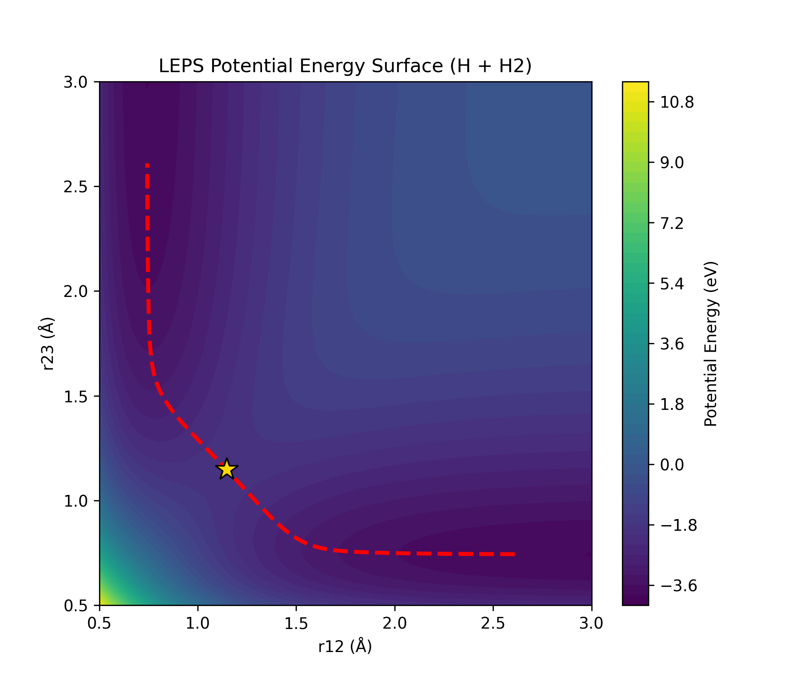

# Quantum Chemical Kinetics & Potential Energy Surface Solver

A computational chemistry solver built in Python to model potential energy surfaces, locate transition states, and map reaction trajectories for collinear exchange reactions ($\text{H} + \text{H}_2$).

## Features
* **LEPS Potential Energy Surface:** Vectorized grid computation of electronic potential energy using Morse potential components.
* **Transition State Optimization:** Custom 1D Newton-Raphson root-finding solver paired with 2D finite-difference partial derivatives.
* **Vibrational Normal Mode Analysis:** $2 \times 2$ Hessian matrix assembly and eigenvalue decomposition (`np.linalg.eig`) to confirm saddle point geometry.
* **Intrinsic Reaction Coordinate (IRC):** Steepest-descent numerical integration along the unstable eigenvector to trace the complete path from reactants to products.

## Project Results

## Tech Stack
* **Language:** Python
* **Libraries:** NumPy, Matplotlib
