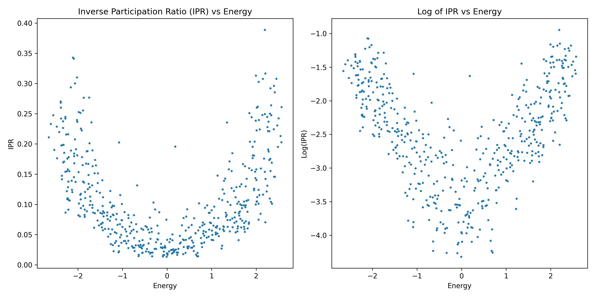
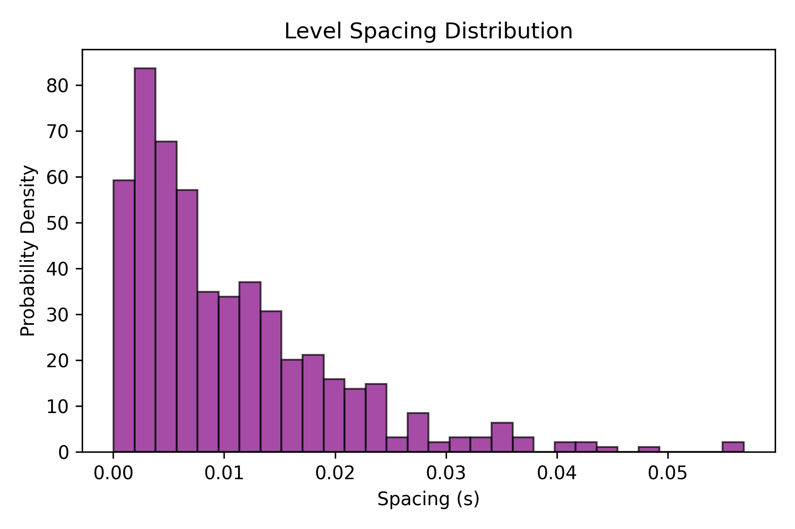

# 1D Anderson Model & Quantum Localization Solver

A computational physics simulation built in Python to model disordered crystal lattices, solve the time-independent Schrödinger equation, and quantify Anderson localization using exact diagonalization.

## Features
* **Tridiagonal Hamiltonian Assembly:** Efficient matrix construction incorporating random on-site energies drawn from a uniform distribution [-W/2, W/2] and constant nearest-neighbor hopping parameters.
* **Exact Diagonalization:** Direct eigenvalue and eigenvector decomposition using `scipy.linalg.eigh_tridiagonal` to extract complete energy spectra across the lattice chain.
* **Inverse Participation Ratio (IPR):** Vectorized calculation of participation metrics ($IPR = \sum \vert{}\psi_i\vert{}^4$) to differentiate between extended and localized wave states across energy bands.
* **Level Spacing Statistics:** Analysis of adjacent energy level gaps ($s = E_{n+1} - E_n$) to evaluate energy level distributions and system insulating properties.

## Project Results

### Inverse Participation Ratio (IPR) Spectrum

### Level Spacing Distribution

## Tech Stack
* **Language:** Python
* **Libraries:** NumPy, SciPy (linalg), Matplotlib