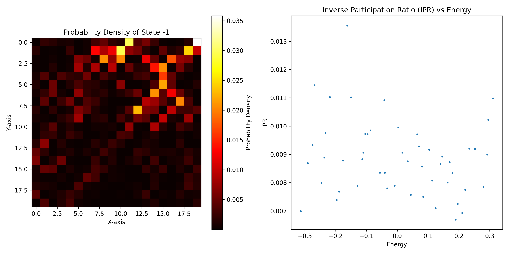
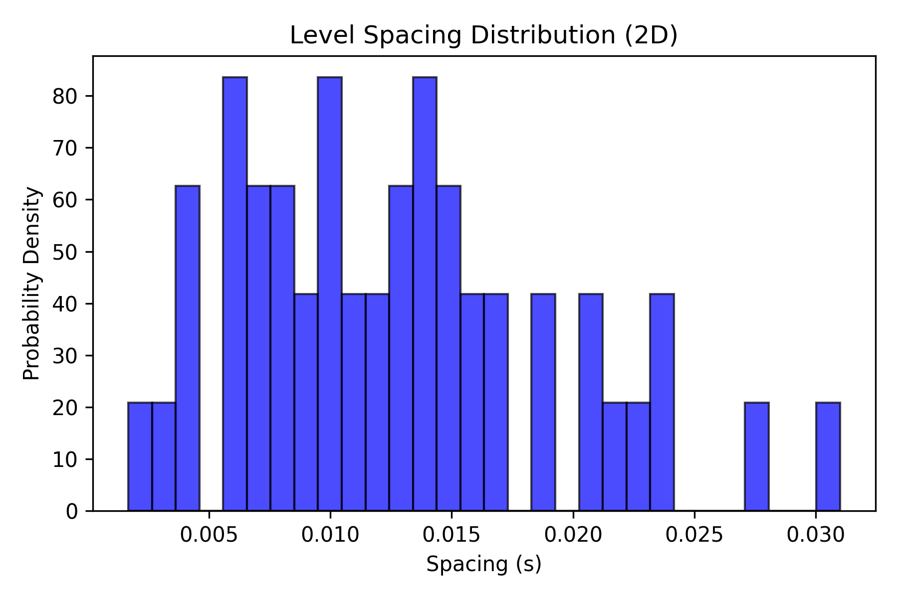

# 2D Anderson Model & Quantum Confinement Solver

An advanced, memory-optimized Python simulation modeling quantum electron localization across a two-dimensional square lattice using sparse linear algebra and coordinate mapping.

## Features
* **2D to 1D Coordinate Mapping:** Row-major indexing translation to map spatial grid coordinates ($x, y$) into a unified linear system index.
* **Sparse Hamiltonian Construction:** Block-tridiagonal matrix assembly utilizing `scipy.sparse.lil_matrix` and Compressed Sparse Row (`.tocsr()`) formatting to handle large spatial grids without memory overhead.
* **Sparse Eigenvalue Solver:** Targeted subspace diagonalization using `scipy.sparse.linalg.eigsh` to compute specific energy states and localized wave functions near the spectrum.
* **Spatial Heatmap Profiling:** Reshaping 1D eigenvectors back into a 2D spatial grid to visually map probability density profiles ($\vert{}\psi\vert{}^2$) of electron trapping.

## Project Results

### 2D Wavefunction Heatmap & IPR

### Level Spacing Distribution (2D)

## Tech Stack
* **Language:** Python
* **Libraries:** NumPy, SciPy (`sparse`, `linalg`), Matplotlib